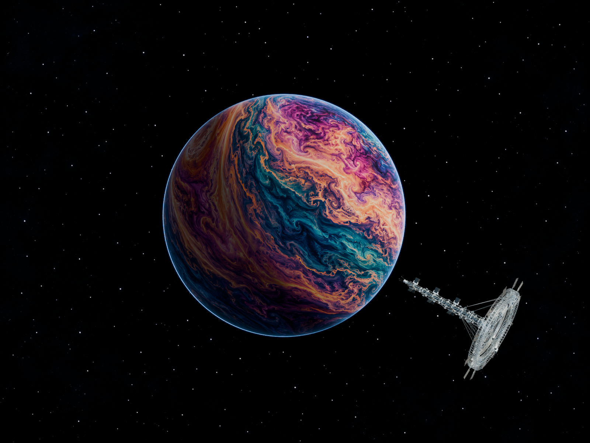

# Orbitalis

An interactive storm planet and detailed orbital ring station, built with Three.js and TypeScript. **Pelagia** is the default scene.

[Live demo](https://winrisef.github.io/Orbitalis/) · [Downloads](https://github.com/WinriseF/Orbitalis/releases/tag/v0.1.0) · [中文说明](README.zh-CN.md)



## Explore

- Rotate the planet independently from the station.
- Drag the visible station around the full orbital sphere, including front and rear passages.
- Watch the station revolve while its annular rotor spins around a fixed hub and mast.
- Zoom around the cursor, pinch on touch devices, and pan with Shift-drag.
- Pause, reset, or use the static preview when the device cannot load the scene.

This first public release preserves the v14 scene, model detail, full texture and fixed 4K drawing-buffer request. It is an artistic scene, not a physical orbital simulation.

## Run locally

Requirements: **Node.js 22 or newer**, npm, and the `tar` command (included with current Windows, macOS and Linux installations).

```sh
git clone https://github.com/WinriseF/Orbitalis.git
cd Orbitalis
npm ci
npm run setup:assets
npm run dev
```

Open **http://localhost:4173/**. Source changes rebuild automatically; refresh the page to see them. The first resource download is large; later runs reuse assets after checking their hashes.

```sh
npm run build
npm run preview
```

The output in `dist/` can be served at a site root or under a directory such as `/Orbitalis/`. Use HTTP(S), not `file://`. Deploy HTTPS in production; model integrity verification uses Web Crypto.

You can also download the complete `orbitalis-v0.1.0-web.zip` from Releases, extract it and serve its contents with any static HTTP server.

## Controls

| Input | Action |
| --- | --- |
| Drag the planet | Rotate only the planet |
| Drag the visible station | Move its orbit through three dimensions |
| Wheel / two-finger pinch | Zoom, with a moving touch midpoint for pan |
| Shift-drag | Pan |
| Arrow keys | Rotate the planet |
| + / − | Zoom |
| Home / reset | Restore the initial view and stop motion |

## Device and download requirements

The native texture is **15360 × 7680**, embedded unchanged in a 181,207,568-byte planet model. The station has 429,760 triangles. The complete runtime is about **195 MiB**; texture storage with mipmaps alone can require roughly **600 MiB of GPU memory**.

The canvas requests a **3840-pixel longest drawing-buffer edge**, independent of device pixel ratio. Devices that cannot support the texture or allocate it show an explicitly labeled static preview. No automatic lower-resolution scene is provided in v0.1.0. Reduced-motion and data-saving preferences defer model loading until explicit interaction.

## Source and releases

Source, scene configuration and preview images live in Git. Large model chunks live in the versioned runtime Release archive; `assets-manifest.json` pins its size and SHA-256. `npm run setup:assets` verifies both the archive and individual chunks.

- `orbitalis-v0.1.0-runtime-assets.tar.gz`: original v14 model chunks.
- `orbitalis-v0.1.0-editable-assets.zip`: Blender files, selected reconstruction/export scripts and the extracted native texture.
- `orbitalis-v0.1.0-web.zip`: ready-to-serve website, including all runtime assets.
- `SHA256SUMS.txt`: checksums for the three downloads.

See [architecture](ARCHITECTURE.md) and [asset provenance and editing](docs/assets.md).

## Development checks

For contributors who choose to run them:

```sh
npm test
npm run build
npm run check
```

The asset checks need downloaded models and a built `dist/`. Existing tests exercise real Three.js transforms and GLB parsing, with WebGL/image decoding mocked where needed. The inherited backup includes offline Blender and static verification, which does not establish browser GPU rendering or cross-device performance. This release does not claim those tests were rerun during publication.

## License

[MIT](LICENSE) for project code and the project scene assets distributed with this release. Third-party dependencies retain their own licenses; see [third-party notices](THIRD_PARTY_NOTICES.md). Recorded asset origins and incomplete source inputs are documented in [docs/assets.md](docs/assets.md).
